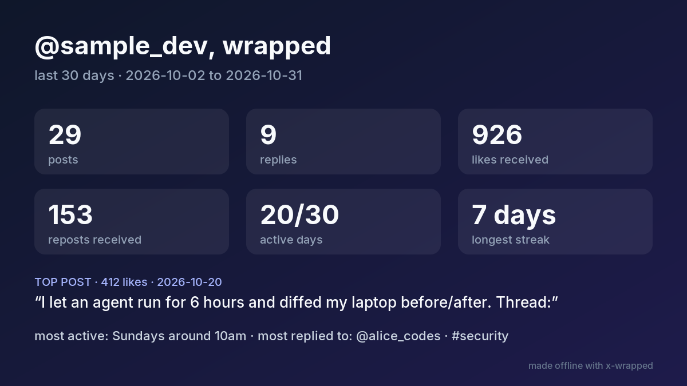

# x-wrapped

Turn your X (Twitter) data archive into a "wrapped" card for the last 30, 90 or any number of days: posts, replies, likes received, active days, longest streak, top post, who you reply to most, top hashtags.

It reads the official archive file on your machine. No API key, no login, no upload, no dependencies (PNG export is an optional extra).



*The card above is rendered from `examples/sample-archive`, a synthetic archive with made-up posts and accounts.*

## Install

```bash
pip install git+https://github.com/jatingargiitk/x-wrapped
# optional, for --png:
pip install "x-wrapped[png] @ git+https://github.com/jatingargiitk/x-wrapped"
```

Python 3.9+.

## Get your archive

On X: **Settings → Your account → Download an archive of your data**. X emails you when it is ready (it can take a day or more). Pass the downloaded `.zip` directly, or the unzipped folder. x-wrapped reads `data/tweets.js` (also `tweet.js` and `tweets-partN.js` from older or larger archives) and `data/account.js` for your handle.

## Usage

Last 30 days ending Oct 31, with hours and days counted in IST, plus an SVG card:

```text
$ x-wrapped examples/sample-archive --until 2026-10-31 --tz +05:30 -o wrapped.svg
@sample_dev, last 30 days (2026-10-02 to 2026-10-31)
  posts            29
  replies          9
  reposts          4
  likes received   926
  reposts received 153
  avg likes/post   31.0
  active days      20/30 (longest streak 7)
  most active      Sundays around 10am
  top post         412 likes, 2026-10-20: I let an agent run for 6 hours and diffed my laptop before/…
  most replied to  @alice_codes (4), @bob_builds (3), @carol_ml (2)
  top hashtags     #security (6), #buildinpublic (4), #ai (4)
  top words        agent (19), reading (7), files (7), new (6), post (6)
wrote wrapped.svg
```

90 days as JSON (here trimmed with `jq`):

```text
$ x-wrapped examples/sample-archive --days 90 --until 2026-10-31 --json | jq -c '{start, end, posts, replies, reposts, likes_received, longest_streak, top_post: .top_post.likes, top_hashtags}'
{"start":"2026-08-03","end":"2026-10-31","posts":82,"replies":22,"reposts":12,"likes_received":2107,"longest_streak":10,"top_post":412,"top_hashtags":[{"name":"ai","count":15},{"name":"buildinpublic","count":11},{"name":"security","count":11}]}
```

PNG for posting on X (needs the `png` extra):

```text
$ x-wrapped examples/sample-archive --until 2026-10-31 --tz +05:30 --png wrapped.png > /dev/null
wrote wrapped.png
```

If the window has no posts, it still prints the empty stats and exits 1:

```text
$ x-wrapped examples/sample-archive --until 2020-01-01; echo "exit code $?"
x-wrapped: no posts in the last 30 days ending 2020-01-01 (archive has 116 posts total)
@sample_dev, last 30 days (2019-12-03 to 2020-01-01)
  posts            0
  replies          0
  reposts          0
  likes received   0
  reposts received 0
  avg likes/post   0
  active days      0/30 (longest streak 0)
exit code 1
```

Options: `--days N` (default 30), `--until YYYY-MM-DD` (inclusive, default now), `--tz +05:30` (default UTC), `--handle NAME` (default from `account.js`), `-o card.svg`, `--png card.png`, `--json`.

## How things are counted

- **posts**: your own posts, including replies to yourself (thread continuations).
- **replies**: replies to other accounts.
- **reposts**: archive entries whose text starts with `RT @`. They don't count toward likes received or top post.
- **likes / reposts received**: the `favorite_count` / `retweet_count` stored in the archive, so they are as of the day you downloaded it, not live.
- **active days / longest streak / most active**: computed in the `--tz` you pass.
- **top words**: a short English stopword list, URLs and @mentions removed.

## Limits

- Needs an archive download; it does not call the X API, so stats are only as fresh as your archive.
- Impressions, profile visits and follower changes are not in `tweets.js`, so they are not shown.
- Quote posts count as posts. Deleted posts (`deleted-tweets.js`) are ignored.
- Card fonts use whatever Inter/Helvetica/Arial your SVG viewer or cairosvg finds.

## Development

```bash
python -m unittest discover -s tests -v
python examples/make_sample.py   # regenerates the synthetic sample archive
```

## License

MIT
